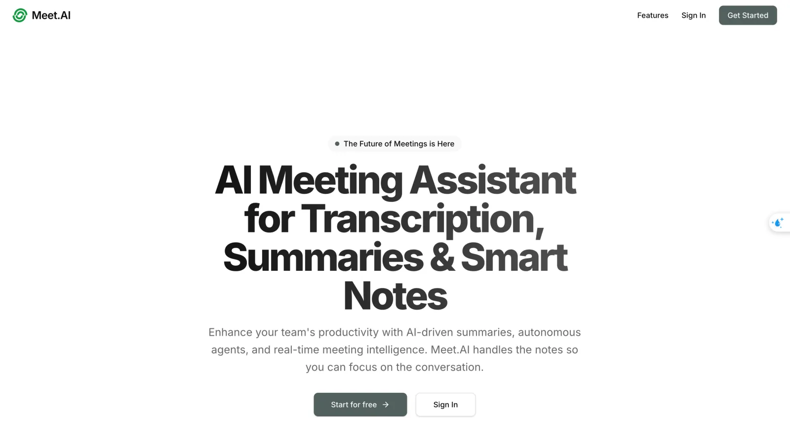
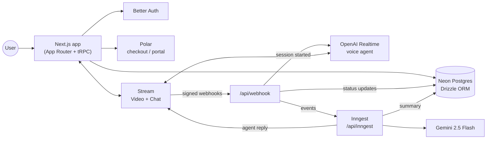

# Meet.AI

Meet.AI is a web app for video meetings with a custom AI agent in the call. You create an agent with its own instructions, start a meeting with it, and talk to it live. After the call you get a recording, a searchable transcript, an AI-written summary, and a chat that answers questions about the meeting.

[](https://meetai-assistant.vercel.app)
[](package.json)
[](LICENSE)

**Live demo:** https://meetai-assistant.vercel.app



## Overview

Meeting notes are tedious to write and easy to lose. Meet.AI lets an AI agent take part in the meeting and handle the follow-up:

1. **During the call:** when a meeting starts, the server connects an **OpenAI Realtime** voice agent to the Stream video call. The agent joins as a participant and follows the instructions you wrote for it.
2. **After the call:** Stream sends the transcript through a webhook. An **Inngest** background job attaches speaker names and asks **Google Gemini 2.5 Flash** for a structured Markdown summary.
3. **Follow-up:** on the completed meeting page you can chat with the agent. **Gemini 2.5 Flash** answers using the meeting summary, the agent's instructions, and the recent chat history.

This is a portfolio project. It was built by working through a chapter-based Next.js SaaS course (commits `01`–`28` follow the chapters) and then extended. Later work includes:
- Gemini instead of OpenAI for summaries and chat
- Facebook login and account linking
- the marketing landing page and SEO metadata
- the dashboard home
- route-level loading states
- the Vercel deployment

## Key features

- **Authentication:** email/password plus Google, GitHub and Facebook OAuth, with account linking (Better Auth). See `src/lib/auth.ts`.
- **AI agents:** create, edit and delete agents (name + system instructions). The list supports search and pagination and shows how many meetings use each agent.
- **Meetings:** create a meeting with one agent and filter by name, status or agent. Filters live in the URL (`nuqs`).
- **Video calls (Stream):** a lobby with camera/mic preview and permission hints, the call itself, and an end screen. Recording (1080p) and English transcription are switched on when the meeting is created.
- **Real-time AI voice agent:** on `call.session_started`, `/api/webhook` calls Stream's `connectOpenAi` helper (OpenAI Realtime API) and sets the session instructions from the agent.
- **Meeting lifecycle:** `upcoming → active → processing → completed`, driven by Stream webhooks.
- **AI summaries:** an Inngest function (`meetings/processing`) fetches the JSONL transcript, matches speakers to users and agents, and saves a Gemini 2.5 Flash summary.
- **Completed meeting view:** tabs for the Markdown summary, transcript search with highlighting, recording playback, and an "Ask AI" chat (Stream Chat).
- **Post-meeting chat:** user messages reach `/api/webhook`, then the Inngest function `chat/message.new`, then Gemini 2.5 Flash. The reply is posted in the channel as the agent.
- **Free tier and upgrades:** free accounts can have 3 agents and 3 meetings, checked server-side in `premiumProcedure`. Upgrades use Polar checkout and the customer portal, and a Polar customer is created on sign-up.
- **Command palette:** <kbd>Cmd/Ctrl</kbd> + <kbd>K</kbd> searches meetings and agents.
- **Landing page and SEO:** OpenGraph/Twitter metadata, `robots.txt` and `sitemap.xml`.

### Which AI does what

| Stage | Provider | Where in code |
| --- | --- | --- |
| Live voice agent inside the call | OpenAI Realtime API (through Stream `connectOpenAi`) | `src/app/api/webhook/route.ts` |
| Meeting summary | Google Gemini `gemini-2.5-flash` via `@inngest/agent-kit` | `src/inngest/functions.ts` (`meetingsProcessing`) |
| "Ask AI" chat after the meeting | Google Gemini `gemini-2.5-flash` via `@inngest/agent-kit` | `src/inngest/functions.ts` (`chatMessageProcessing`) |

## Tech stack

| Layer | Technology |
| --- | --- |
| Framework | Next.js 15.3 (App Router), React 19, TypeScript 5 |
| UI | Tailwind CSS 4, shadcn/ui (Radix UI), lucide-react, DiceBear avatars |
| API | tRPC 11 + TanStack Query 5, Zod 4, nuqs (URL state) |
| Database | PostgreSQL on Neon, Drizzle ORM 0.43 (`drizzle-orm/neon-http`), drizzle-kit |
| Auth | Better Auth (email/password, Google, GitHub, Facebook) |
| Video & chat | Stream Video (React SDK + Node SDK), Stream Chat |
| Background jobs | Inngest 3 + `@inngest/agent-kit` |
| AI | OpenAI Realtime API (via Stream), Google Gemini 2.5 Flash |
| Payments | Polar (`@polar-sh/sdk`, `@polar-sh/better-auth`), sandbox environment |
| Hosting | Vercel |

## Architecture

The app is one Next.js project. Pages and server components prefetch tRPC queries, and client components read them with `useSuspenseQuery` inside `Suspense` and `ErrorBoundary`. Stream sends signed webhooks to `/api/webhook`. That route updates the meeting status and sends Inngest events, which run the AI work in the background.



### Meeting lifecycle

| Stream webhook | Effect |
| --- | --- |
| `call.session_started` | Meeting becomes `active`, `startedAt` is set, and the OpenAI Realtime agent joins with the agent's instructions |
| `call.session_participant_left` | The call is ended |
| `call.session_ended` | Meeting becomes `processing`, `endedAt` is set |
| `call.transcription_ready` | `transcriptUrl` is saved and Inngest `meetings/processing` is queued (summary → `completed`) |
| `call.recording_ready` | `recordingUrl` is saved |
| `message.new` (chat, completed meetings only) | Inngest `chat/message.new` is queued and Gemini replies as the agent |

### Data model

`src/db/schema.ts` holds two groups of tables:
- Better Auth tables: `user`, `session`, `account`, `verification`.
- App tables:
  - `agents`: `name`, `instructions`, `userId`
  - `meetings`: `name`, `userId`, `agentId`, `status` enum, `startedAt`, `endedAt`, `transcriptUrl`, `recordingUrl`, `summary`

## Project structure

```text
src/
├── app/
│   ├── (auth)/              # sign-in, sign-up pages
│   ├── api/
│   │   ├── auth/[...all]/   # Better Auth handler
│   │   ├── trpc/[trpc]/     # tRPC handler
│   │   ├── inngest/         # Inngest serve endpoint
│   │   └── webhook/         # Stream Video + Chat webhooks
│   ├── call/[meetingId]/    # full-screen call page
│   ├── dashboard/           # home, agents, meetings, upgrade (+ loading states)
│   ├── page.tsx             # marketing landing page
│   ├── robots.ts, sitemap.ts
├── components/              # shared states, data table, responsive dialog, shadcn/ui
├── db/                      # Drizzle client + schema
├── inngest/                 # Inngest client and functions (summary, chat)
├── lib/                     # auth, Polar, Stream clients, avatar helper
├── modules/                 # feature modules: agents, meetings, call, premium, dashboard, auth, home
└── trpc/                    # tRPC init (protected/premium procedures), routers, clients
```

## Getting started

### Prerequisites

- Node.js 20+ and npm
- A [Neon](https://neon.tech) Postgres database. The app uses Neon's HTTP driver, so a plain local Postgres will not work without changes.
- A [Stream](https://getstream.io) app with Video and Chat enabled
- An OpenAI API key with Realtime API access
- A Google AI Studio (Gemini) API key
- A [Polar](https://polar.sh) **sandbox** organization access token, plus at least one recurring product
- OAuth credentials for Google, GitHub and Facebook (only for the providers you want to use)
- [ngrok](https://ngrok.com) or another tunnel, so Stream webhooks can reach your machine

### Install and run

```bash
git clone https://github.com/tinhne/meetai.git
cd meetai
npm install --legacy-peer-deps
```

Create `.env` in the project root (see [Environment variables](#environment-variables)), then push the schema:

```bash
npm run db:push
```

Start the app and the Inngest Dev Server in two terminals:

```bash
npm run dev                       # http://localhost:3000
npx inngest-cli@latest dev        # Inngest Dev Server, http://localhost:8288
```

### Webhooks (needed for the AI agent, summaries and chat)

1. Expose port 3000 publicly. `npm run dev:webhook` runs ngrok with the author's static domain. Change the `--url` in `package.json` to your own ngrok domain, or run `ngrok http 3000`.
2. In the Stream dashboard, set the **Video** and **Chat** webhook URLs to `https://<your-public-domain>/api/webhook`.
3. The webhook route checks signatures with the Video API secret. Chat webhooks pass only if Chat uses the same Stream app credentials.

Other useful scripts: `npm run db:studio` (Drizzle Studio), `npm run lint`, `npm run build` / `npm start`.

## Environment variables

| Name | Required | Description |
| --- | --- | --- |
| `DATABASE_URL` | Yes | Neon Postgres connection string (app and `drizzle.config.ts`) |
| `BETTER_AUTH_SECRET` | Yes | Secret used by Better Auth to sign sessions (read by the library) |
| `BETTER_AUTH_URL` | Yes | Base URL of the app, e.g. `http://localhost:3000` (read by the library) |
| `NEXT_PUBLIC_APP_URL` | Yes | Public base URL, used for server-side tRPC calls, metadata, robots and sitemap |
| `GOOGLE_CLIENT_ID` / `GOOGLE_CLIENT_SECRET` | For Google login | Google OAuth app |
| `GITHUB_CLIENT_ID` / `GITHUB_CLIENT_SECRET` | For GitHub login | GitHub OAuth app |
| `FACEBOOK_CLIENT_ID` / `FACEBOOK_CLIENT_SECRET` | For Facebook login | Facebook OAuth app |
| `NEXT_PUBLIC_STREAM_VIDEO_API_KEY` | Yes | Stream Video API key (browser + server) |
| `STREAM_VIDEO_SECRET_KEY` | Yes | Stream Video secret (tokens, call creation, webhook verification) |
| `NEXT_PUBLIC_STREAM_CHAT_API_KEY` | Yes | Stream Chat API key (browser + server) |
| `STREAM_CHAT_SECRET_KEY` | Yes | Stream Chat secret (chat tokens, agent replies) |
| `OPENAI_API_KEY` | Yes | OpenAI key for the real-time voice agent in calls |
| `GOOGLE_AI_API_KEY` | Yes | Gemini key for meeting summaries and the Ask AI chat |
| `POLAR_ACCESS_TOKEN` | Yes | Polar **sandbox** organization access token |
| `INNGEST_EVENT_KEY` / `INNGEST_SIGNING_KEY` | Production only | Read by the Inngest SDK when deployed (not needed with the local Dev Server) |

```env
DATABASE_URL=your-neon-connection-string
BETTER_AUTH_SECRET=your-secret-here
BETTER_AUTH_URL=http://localhost:3000
NEXT_PUBLIC_APP_URL=http://localhost:3000

GOOGLE_CLIENT_ID=your-google-client-id
GOOGLE_CLIENT_SECRET=your-google-client-secret
GITHUB_CLIENT_ID=your-github-client-id
GITHUB_CLIENT_SECRET=your-github-client-secret
FACEBOOK_CLIENT_ID=your-facebook-client-id
FACEBOOK_CLIENT_SECRET=your-facebook-client-secret

NEXT_PUBLIC_STREAM_VIDEO_API_KEY=your-stream-video-key
STREAM_VIDEO_SECRET_KEY=your-stream-video-secret
NEXT_PUBLIC_STREAM_CHAT_API_KEY=your-stream-chat-key
STREAM_CHAT_SECRET_KEY=your-stream-chat-secret

OPENAI_API_KEY=your-openai-key
GOOGLE_AI_API_KEY=your-gemini-key
POLAR_ACCESS_TOKEN=your-polar-sandbox-token
```

## API reference

### HTTP routes

| Method | Path | Auth | Description |
| --- | --- | --- | --- |
| GET, POST | `/api/auth/*` | – | Better Auth handler (sign-in/up, OAuth callbacks, Polar checkout/portal plugin) |
| GET, POST | `/api/trpc/*` | Session | tRPC endpoint (procedures below) |
| GET, POST, PUT | `/api/inngest` | Inngest signing | Inngest functions `meetings/processing`, `chat/message.new` |
| POST | `/api/webhook` | Stream signature (`x-signature`) | Stream Video + Chat events |

### tRPC procedures

All procedures need a signed-in session. Procedures marked "premium" also enforce the free-tier limits.

| Procedure | Type | Description |
| --- | --- | --- |
| `agents.getMany` | query | Paginated list of the user's agents, with search |
| `agents.getOne` | query | One agent with its meeting count |
| `agents.create` | mutation (premium) | Create an agent |
| `agents.update` / `agents.remove` | mutation | Update or delete an agent owned by the user |
| `meetings.getMany` | query | Paginated meetings with search, status and agent filters, plus duration |
| `meetings.getOne` | query | One meeting with its agent and duration |
| `meetings.create` | mutation (premium) | Create a meeting and its Stream call (recording + transcription on) |
| `meetings.update` / `meetings.remove` | mutation | Update or delete a meeting owned by the user |
| `meetings.generateToken` | mutation | Stream Video user token (1 hour) |
| `meetings.generateChatToken` | mutation | Stream Chat user token |
| `meetings.getTranscription` | query | Transcript items with speaker names and avatars |
| `premium.getProducts` | query | Active recurring Polar products |
| `premium.getCurrentSubscription` | query | Product of the user's active subscription, if any |
| `premium.getFreeUsage` | query | Agent and meeting counts for free users |

## Deployment

The app is deployed on Vercel at **https://meetai-assistant.vercel.app**. A production deployment also needs:
- Stream webhooks pointing at `/api/webhook`
- the app synced in Inngest Cloud
- every variable above set in Vercel

Payments use Polar's **sandbox** environment (`src/lib/polar.ts`), so no real charges are made.

## Known limitations

- Polar is hard-coded to the sandbox server.
- The `cancelled` status and its UI exist, but no action sets a meeting to cancelled yet.
- Meetings have no scheduled date or time. A meeting is "upcoming" until someone starts the call.
- Transcription language is fixed to English.
- When any participant leaves, the call ends for everyone (`call.session_participant_left`).
- Stream users are created with the `admin` role. A production version should use the `user` role and per-call/channel permissions.
- Meeting create/update does not yet check that the selected agent belongs to the current user.
- The schema is applied with `drizzle-kit push`, and there is no migration history.
- There are no automated tests or CI.
- Dark-mode tokens exist in `globals.css` but are not wired to a theme switcher.

## Author

**Lê Văn Trung Tính** — Software Engineer | AI Product Builder

- Website: [trungtinh.site](https://trungtinh.site)
- GitHub: [@tinhne](https://github.com/tinhne)

## License

Released under the [MIT License](LICENSE).
